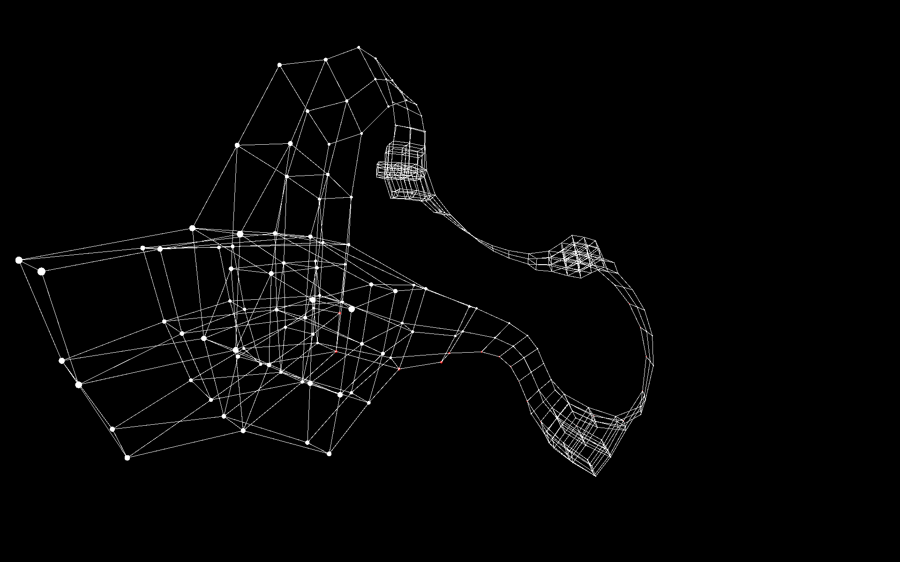
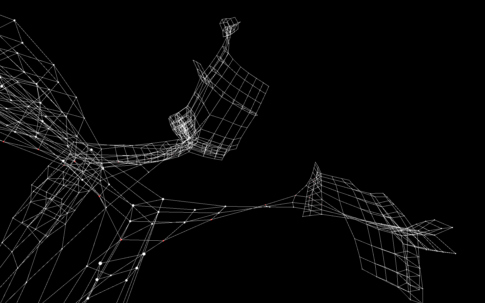
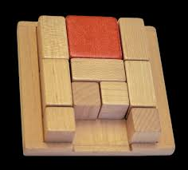
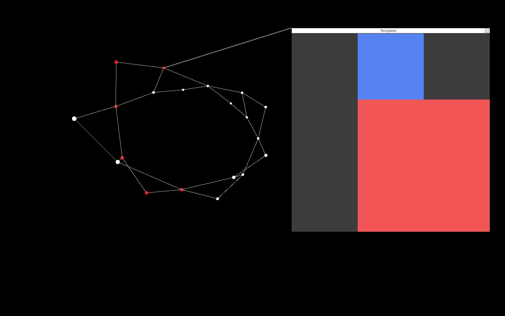
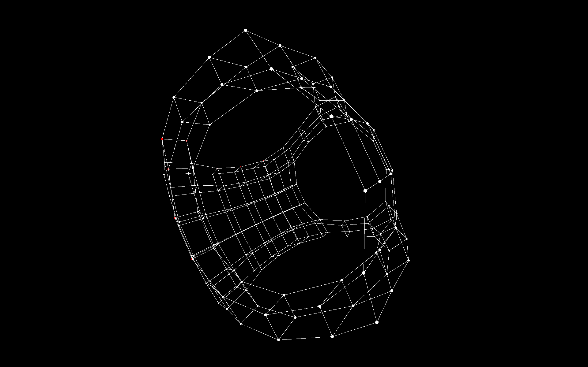

<h1> Puzzled Programmers - DSA Project 2 submission </h1>



By Joseph Parayil & Demetri Delerme

## Overview
Our project generates the graph-representation of state spaces which underly discrete puzzle games (namely the sliding block game Klotski), displays this graph in an interactive 3D visualizer, using a wireframe rendering engine made from scratch (C++ & SFML). The nodes are subjected to a simple physics simulation involving treating the edges as springs (hooke's law) and having the nodes repel each other (columb's law), to properly lay out the nodes based on whom they are connected to in an open 3D space. The purpose of this simulation is visualize the shortest path (which is indicated by a sequence of red nodes) computed by graph search algorithms (BFS & A*) to demonstrate the fundamental connection between graph-search and problem-solving. The performance of both algorithms in terms of how many nodes searched to obtain the shortest path is also provided to compare their efficiencies.

## Motivation
The problem this project is trying to solve is a research problem. We are trying to determine under which set of circumstances the search algorithm A* outperforms BFS in terms of time and vice versa. We believe that by testing these algorithms on a diverse range of discrete puzzles, we may gain interesting insights on relative performance differences of the two algorithms. Specifically, are there any set of useful conditions in which BFS can end up outperforming A*?

## Instructions
1. After cloning the repository, generate the cmake build system with:
```cmake -S . -B build```
2. Build the project with:
```cmake --build build```
- Ensure that this is run on the StateSpaceSearch (parent) directory. This will take some time as the SFML & TGUI files will need to be cloned
3. Finally, run the built executable:
```build/ss.exe```
4. Ignore the SFML window that appears. In the command line, you will immediately be prompted to select a initial board state from an option of 5 boards. Enter the number (0-4) which corresponds with the board you would like to explore. After this, a graph will be generated by exhausting all possible state-action pairs, which may take some time. A sequence of numbers which are multiples of 300 will be printed. This is simply to give a sense of how fast the klotski exploration is taking.
5. After the graph is generated, you may observe some information regarding the size of the generated state-space and the results of the BFS & A* pathfinder algorithms. Switch to the SFML window to view the emerging graph in 3D.
<br>**3D camera instructions:**
- To pause/unpause the physics simulation, press space.
  	- It is recommended to let the physics play out in the beginning to let the system resolve to an ordered state
  	- Pausing the physics simulation on the other hand will allow higher FPS
- To pan the camera, either:
	- Hold right-click and move the mouse
   	- Press esc to toggle mouse-lock and move the mouse without right-click
- To move the camera, use WASD as well as E to move up and Q to move down. Hold CTRL to go fast and 
- Use the scroll-wheel to increase or decrease FOV. Press R to reset FOV.
- To select a node to inspect, either:
  	- Hover the mouse until the node turns blue and click it
  	- Click and drag empty space to create a rectangular selection that selects the first node closest to you in that area
- Nodes colored red indicate the shortest path computed by the graph search	










## Acknowledgements
This project was highly inspired by the educational youtuber twoswap, specifically his video titled 'I Solved Klotski' (https://www.youtube.com/watch?v=YGLNyHd2w10).
About a year ago, this served as inspiration to develop the C++ 3D rendering engine with the eventual goal of visualizing complex graph structures in 3D. 
This project's choice of the Klotski puzzle was also directly inspired from his demonstrating of the interesting structures that emerge from the state spaces of this puzzle.

This project builds upon several underlying personal libraries (including the 3D wireframe engine) built ~10 months beforehand, <ins>treated as dependencies</ins>. These were not vibecoded but rather represent mostly original human work driven out of interest and a desire to improve programming skills. 
